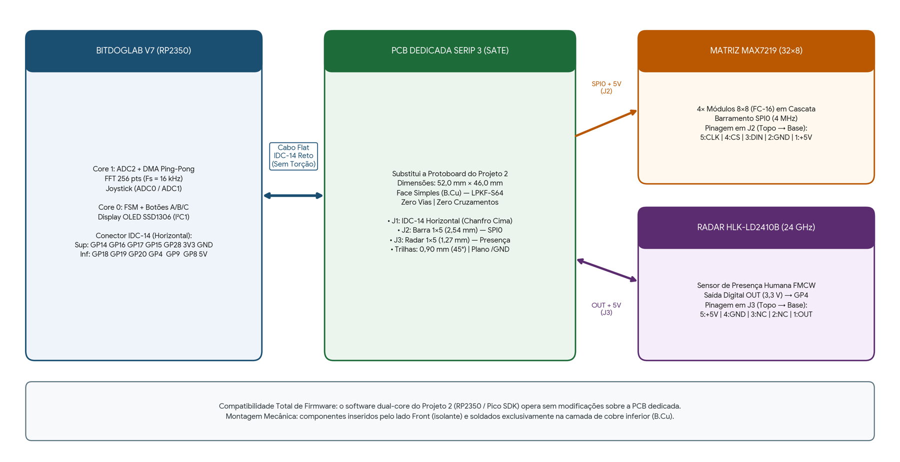
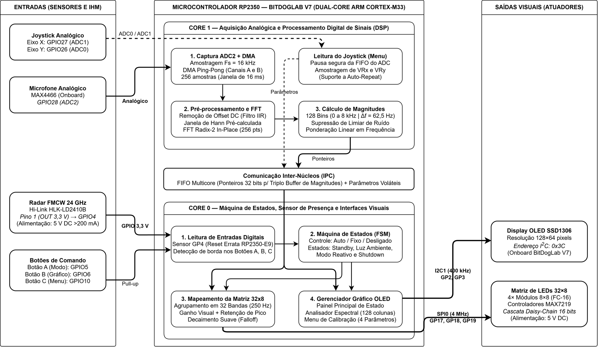
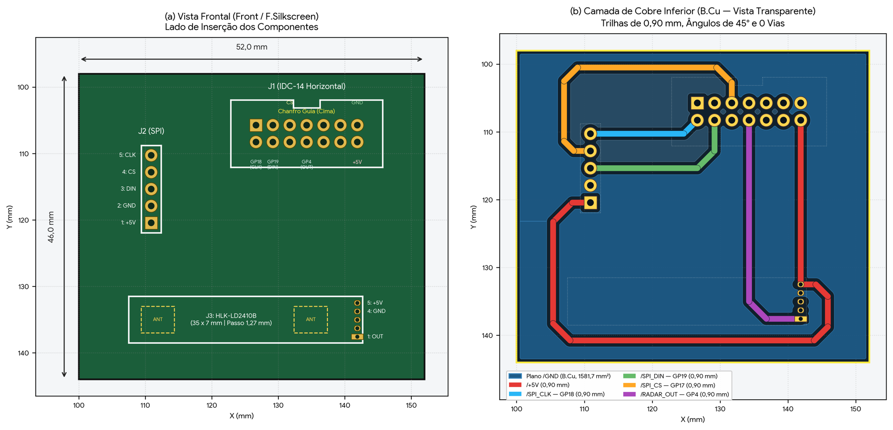

# SERIP — Sistema Embarcado Reativo de Iluminação e Presença


Sistema embarcado desenvolvido na disciplina **EA801 — Laboratório de Projetos de Sistemas Embarcados**, da Faculdade de Engenharia Elétrica e de Computação (FEEC/UNICAMP).

O SERIP combina visualização espectral de áudio em tempo real e controle de iluminação baseado na presença humana, utilizando a plataforma [BitDogLab V7](https://github.com/BitDogLab/BitDogLab), com RP2350. O Projeto 3 consolida a integração do hardware em uma PCB dedicada, mantendo o firmware do Projeto 2.

## Visão geral



### Funcionalidades

- Análise de áudio por FFT de 256 pontos, à frequência de amostragem de 16 kHz.
- Aquisição por ADC e DMA com buffers alternados, processamento em dois núcleos.
- Visualização em matriz de LEDs monocromática 32 × 8, com quatro MAX7219 em cascata.
- Controle automático por sensor radar de presença HLK-LD2410B.
- Modos automático, reativo e desligado, selecionáveis pelo usuário.
- Display OLED com telemetria, gráfico espectral e menu de calibração.
- Placa adaptadora dedicada, eliminando a protoboard utilizada na etapa anterior.

## Evolução do projeto

| Etapa | Desenvolvimento |
| --- | --- |
| Projeto 1 | Protótipo inicial com captação de áudio, matriz de LEDs e interface OLED na BitDogLab. |
| Projeto 2 | Matriz externa MAX7219, radar HLK-LD2410B e expansão da interface e da análise espectral. |
| Projeto 3 | Integração em placa de circuito impresso dedicada, projetada no KiCad para fabricação no SATE/FEEC. |

## Arquitetura



O núcleo 1 do RP2350 é responsável por aquisição do áudio, remoção de offset DC, aplicação da janela Hann e cálculo da FFT. O núcleo 0 gerencia o radar, a comunicação SPI com a matriz, os botões e o OLED. A comunicação entre os núcleos é feita pela FIFO multicore.

| Parâmetro | Valor |
| --- | --- |
| Frequência de amostragem | 16 kHz |
| FFT | 256 pontos |
| Duração de cada bloco | 16 ms |
| Limite de Nyquist | 8 kHz |
| Espaçamento espectral | 62,5 Hz |
| Resolução nominal da matriz | 250 Hz por coluna |
| Comunicação com a matriz | SPI0, 4 MHz |
| Comunicação OLED | I²C1, 400 kHz |

## Hardware

| Componente | Sinal / GPIO |
| --- | --- |
| Microfone MAX4466 (onboard) | GPIO28 — ADC2 |
| Sensor HLK-LD2410B | GPIO4 — OUT |
| Matriz MAX7219 | GPIO17 — CS; GPIO18 — SCK; GPIO19 — DIN |
| OLED SSD1306 | GPIO2 — SDA; GPIO3 — SCL |
| Botão A | GPIO5 |
| Botão B | GPIO6 |
| Botão C | GPIO10 |
| Joystick | GPIO27 — X; GPIO26 — Y |

O sensor e a matriz utilizam alimentação de 5 V e terra comum. A saída digital do radar é de 3,3 V; os pinos UART permanecem sem conexão nesta versão. Confira a correspondência física do IDC de 14 pinos, a polaridade e a orientação dos módulos antes de ligar.

### PCB do Projeto 3



- Dimensões: 52 × 46 mm.
- Face única de cobre (B.Cu), sem vias.
- Largura de trilhas de 0,90 mm, conforme a versão final descrita no relatório.
- J1: interface IDC-14 da BitDogLab.
- J2: conexão da matriz MAX7219.
- J3: conexão do radar HLK-LD2410B (passo de 1,27 mm).
- Plano de terra e contorno de recorte definidos no KiCad.

[Consultar esquemático da PCB](docs/images/esquematico_pcb.png) · [Consultar relatório técnico](docs/Relatorio_Projeto_3.pdf)

O esquemático de montagem do Projeto 2, fornecido com o código, também está disponível em [PDF](docs/esquematico_montagem.pdf) e [SVG](docs/esquematico_montagem.svg). Os arquivos editáveis do KiCad, a biblioteca de footprints e os Gerbers de fabricação do Projeto 3 estão disponíveis em [pcb-prototyping/](pcb-prototyping/). Consulte o [guia do hardware](pcb-prototyping/README.md) para abrir o projeto ou acessar os arquivos de fabricação.

## Operação

| Comando | Ação |
| --- | --- |
| Botão A | Alterna entre automático (presença → iluminação ambiente, ausência → espera), reativo e desligado. |
| Botão B | Alterna entre painel de estado e gráfico espectral. |
| Botão C | Abre ou fecha o menu de configuração. |
| Joystick Y | Seleciona o parâmetro. |
| Joystick X | Ajusta o valor. |

| Parâmetro | Padrão | Faixa |
| --- | ---: | ---: |
| Limiar de ruído | 20 | 0–500 |
| Teto de energia | 800 | 100–3000 |
| Ganho visual | 1,50 | 0,5–5,0 |
| Velocidade de queda | 1,00 | 0,1–5,0 |

Os ajustes são mantidos em RAM e retornam aos valores padrão após a reinicialização.

## Compilação e gravação

### Pré-requisitos

- BitDogLab V7 com Raspberry Pi Pico 2 W (RP2350).
- Raspberry Pi Pico SDK (o projeto original usa 2.3.1).
- CMake, Ninja e toolchain ARM compatível.
- Opcional: VS Code com a extensão oficial Raspberry Pi Pico.

### Via VS Code

1. Abra a pasta raiz deste repositório.
2. Instale a extensão Raspberry Pi Pico e configure o SDK.
3. Selecione a placa `pico2_w`.
4. Compile o projeto e localize `build/SERIP.uf2`.

### Via terminal

Configure a variável de ambiente `PICO_SDK_PATH` para apontar para uma instalação do [Pico SDK](https://github.com/raspberrypi/pico-sdk) com seus submódulos inicializados e disponibilize a toolchain ARM no PATH.

```bash
cmake -S . -B build -G Ninja -DPICO_BOARD=pico2_w
cmake --build build
```

### Gravação

1. Com a placa desligada, desconecte os periféricos externos, se necessário.
2. Conecte a placa ao USB mantendo pressionado BOOTSEL.
3. Copie `build/SERIP.uf2` para a unidade de armazenamento exibida.
4. Aguarde a reinicialização automática.

Também está disponível o [UF2 original fornecido com o projeto](firmware/SERIP.uf2), preservado sem recompilação.

## Estrutura do repositório

```text
SERIP/
├── README.md
├── CMakeLists.txt
├── pico_sdk_import.cmake
├── main.c
├── ws2812.pio
├── inc/
│   ├── ssd1306.c
│   └── ssd1306.h
├── firmware/
│   └── SERIP.uf2
├── docs/
│   ├── Relatorio_Projeto_3.pdf
│   ├── esquematico_montagem.pdf
│   ├── esquematico_montagem.png
│   ├── esquematico_montagem.svg
│   ├── esquematico_montagem.py
│   └── images/
├── pcb-prototyping/
│   ├── serip2_sate.kicad_pro
│   ├── serip2_sate.kicad_sch
│   ├── serip2_sate.kicad_pcb
│   ├── fp-lib-table
│   ├── serip2_sate.pretty/
│   └── gerbers/
└── .vscode/
```

O código-fonte e os arquivos de configuração do pacote original foram preservados; arquivos temporários de compilação foram omitidos. A presença do arquivo UF2 original não representa uma nova validação de compilação.

## Documentação e validação

- [Relatório completo do Projeto 3 (PDF)](docs/Relatorio_Projeto_3.pdf)
- [Esquemático de montagem anterior (Projeto 2)](docs/esquematico_montagem.pdf)
- [Guia de validação da PCB](docs/VALIDACAO.md)
- [Projeto KiCad e arquivos de fabricação](pcb-prototyping/README.md)

**Estado atual:** sistema integrado à PCB dedicada e operando conforme as funcionalidades previstas do Projeto 3. O firmware disponibilizado é o SERIP 2, reaproveitado nesta etapa.

## Referências

- [BitDogLab — repositório oficial](https://github.com/BitDogLab/BitDogLab)
- [RP2350 — datasheet](https://datasheets.raspberrypi.com/rp2350/rp2350-datasheet.pdf)
- [Raspberry Pi Pico SDK](https://github.com/raspberrypi/pico-sdk)
- [MAX7219/MAX7221 — datasheet](https://www.analog.com/media/en/technical-documentation/data-sheets/MAX7219-MAX7221.pdf)
- [Hi-Link — HLK-LD2410B, protocolo e pinagem](https://r0.hlktech.com/download/HLK-LD2410B-24G/1/LD2410B%20%E4%B8%B2%E5%8F%A3%E9%80%9A%E4%BF%A1%E5%8D%8F%E8%AE%AE%20V1.08.pdf)
- [KiCad](https://www.kicad.org/)

## Autores

- **Fernando Cesar Rodrigues da Silva**
- **Pedro da Costa Viana**

FEEC — Universidade Estadual de Campinas (UNICAMP), 2026.

Projeto acadêmico. Nenhuma licença própria foi declarada pelos autores no pacote original; os componentes de terceiros mantêm suas respectivas condições de uso.
