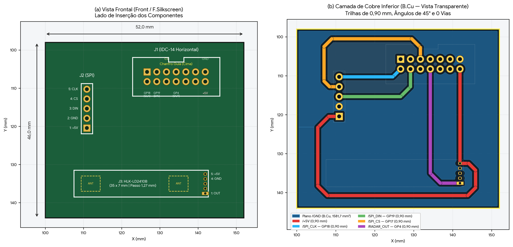

# PCB dedicada — SERIP / Projeto 3

Placa adaptadora desenvolvida para integrar a BitDogLab V7, a matriz MAX7219 de 32 × 8 LEDs e o sensor de presença HLK-LD2410B, substituindo a protoboard do Projeto 2.

## Arquivos de projeto

| Arquivo | Descrição |
| --- | --- |
| [serip2_sate.kicad_pro](serip2_sate.kicad_pro) | Projeto KiCad e regras de projeto |
| [serip2_sate.kicad_sch](serip2_sate.kicad_sch) | Esquemático elétrico |
| [serip2_sate.kicad_pcb](serip2_sate.kicad_pcb) | Layout da placa |
| [fp-lib-table](fp-lib-table) | Tabela da biblioteca local |
| [serip2_sate.pretty/](serip2_sate.pretty/) | Footprints personalizados dos conectores J1, J2 e J3 |
| [gerbers/](gerbers/) | Arquivos de fabricação Gerber e Excellon |

## Abrindo no KiCad

1. Baixe o repositório completo (Code → Download ZIP) ou clone-o.
2. Utilize o KiCad **10.0** ou uma versão compatível com os arquivos de origem.
3. Abra `serip2_sate.kicad_pro` nesta pasta.
4. Mantenha `fp-lib-table` e `serip2_sate.pretty/` junto ao projeto para carregar os footprints locais.

Os arquivos originais de projeto foram preservados. Arquivos temporários, bloqueios de edição e histórico interno não fazem parte do pacote.

## Fabricação

O layout foi desenvolvido para fresagem em face única no SATE/FEEC-UNICAMP: cobre ativo em B.Cu, 25 segmentos de trilha de 0,90 mm e nenhuma via, conforme o projeto original.

| Arquivo | Finalidade |
| --- | --- |
| [B_Cu](gerbers/serip2_sate-B_Cu.gbr) | Cobre inferior |
| [B_Mask](gerbers/serip2_sate-B_Mask.gbr) | Máscara inferior |
| [Edge_Cuts](gerbers/serip2_sate-Edge_Cuts.gbr) | Contorno da placa |
| [PTH.drl](gerbers/serip2_sate-PTH.drl) | Furação de componentes |
| [NPTH.drl](gerbers/serip2_sate-NPTH.drl) | Arquivo complementar de furação não metalizada |
| [gbrjob](gerbers/serip2_sate-job.gbrjob) | Metadados do conjunto Gerber |

A fabricação no SATE deve seguir as especificações do relatório (face única, sem metalização de furos), independentemente da classificação exportada pelo KiCad. Antes de fabricar uma nova unidade, confira o conjunto de Gerbers no visualizador e confirme a pinagem e polaridade da montagem.

[Relatório técnico completo](../docs/Relatorio_Projeto_3.pdf) · [Guia de validação](../docs/VALIDACAO.md)
